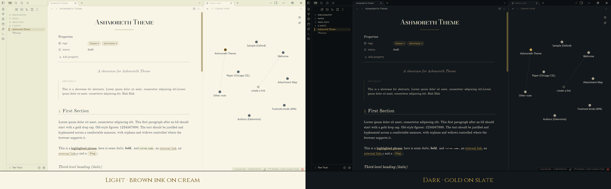
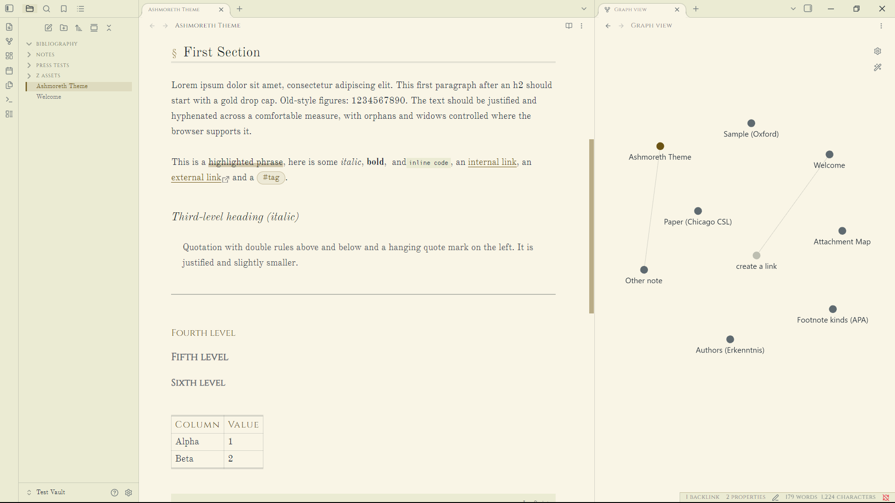
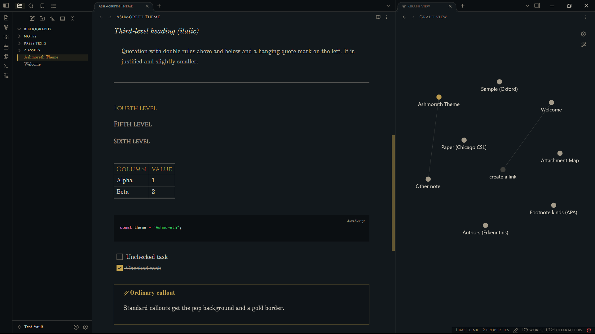

<h1 align="center">Ashmoreth</h1>

<p align="center"><em>An Obsidian theme that makes your notes read like a printed book.</em></p>



Justified serif text, Subtitles and Abstracts, drop caps, § before section headings, double-rule blockquotes and an asterism (⁂) for `---`. It comes in two palettes and works offline, because every font is embedded.

| | |
|---|---|
| **Dark** | gold on slate |
| **Light** | brown ink on cream |

## Install

**From Obsidian** (once it's listed): *Settings → Appearance → Themes → Manage*, search for **Ashmoreth**, then click *Install and use*.

**By hand:** copy `manifest.json` and `theme.css` into `<vault>/.obsidian/themes/Ashmoreth/`, then pick **Ashmoreth** under *Settings → Appearance → Themes*.

## What it does

### Typography
- Every **h2** gets a § and a rule under it. The first paragraph after it opens with a gold **drop cap** (reading view only).
- The note title and h1 are set in Bodoni small caps, centred over a gold double rule.
- h3 is italic. h4–h6 are in Cinzel caps.
- Body text is justified and hyphenated, with old-style figures.

### Blocks
- **Blockquotes** sit between two rules with a hanging quote mark instead of the usual side bar.
- `---` becomes **⁂**.
- `==highlights==` become a marker underline instead of a filled block.
- Tables get Cinzel headers and thin ruled cells.

### Interface
- Narrower tabs, with a gold line under the active one.
- A smaller file explorer, with folders in caps and a gold bar on the open note.
- Backlinks at the bottom of a note stay faded until you hover over them.

<p align="center">
  
  
</p>

## Extra callouts

```markdown
> [!subtitle]
> A centred italic line under the note title

> [!abstract] Abstract
> A short summary, always expanded, with a thin gold rule on the left.
```

`[!note]` callouts get a gold title and icon. Other callout types keep Obsidian's own colours.

## Tweaking

Everything you'd want to change is grouped and commented in `theme.css`:

| What | Where | Default |
|---|---|---|
| UI sizes (text, icons, tabs, bars) | the **WORKSPACE** block | Smaller than stock Obsidian. Delete the block to get the normal sizes back. |
| Hide Obsidian Sync icons | the **hide sync icons** block | Off. Uncomment the block to turn it on. |
| Fading backlinks | the **hovermaxxing** block | On. Delete the block to turn it off. |

> The UI sizes suit my screen but can feel small on laptops, so adjust them to taste.

## Fonts

All fonts are embedded and free to redistribute. See [FONTS.md](FONTS.md).

| CSS name | Font | Used for |
|---|---|---|
| AshDisplay | Bodoni Moda SC | Note title, h1, drop caps |
| AshNav | Cinzel | h4–h6, tabs, sidebar, table headers |
| AshBody | Old Standard TT | Body text |
| AshMono | basis33 | Code and properties |

## Licence

Theme code: MIT, see [LICENSE](LICENSE). Fonts: OFL / MIT, see [FONTS.md](FONTS.md).
